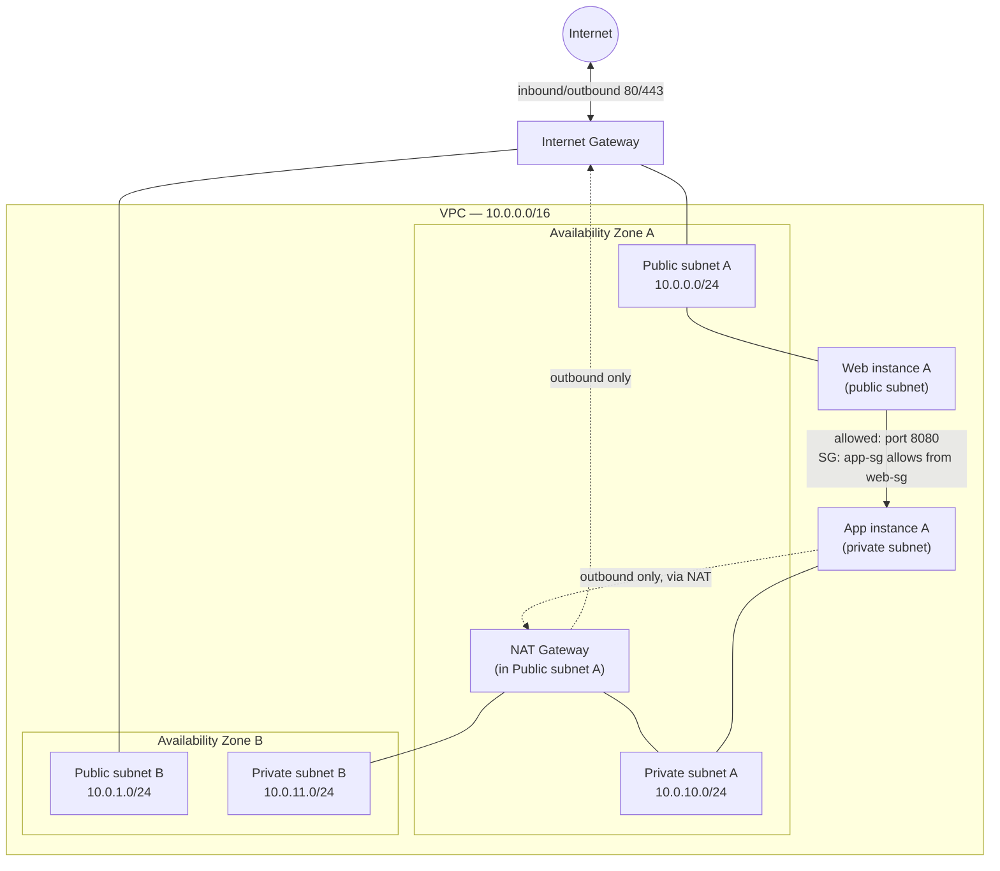

# AWS VPC Networking Fundamentals

A Terraform-built **two-tier VPC** across two Availability Zones — public and private subnets, an Internet Gateway, a NAT Gateway, and security groups wired together the way a real application would use them. Built while studying the "Cloud Technology and Services" / networking portion of the **AWS Certified Cloud Practitioner (CLF-C02)** exam.

> ⚠️ **Status**: this Terraform configuration was hand-written against the AWS provider docs and reviewed manually; `terraform validate`/`apply` have **not** been run — this environment has no Terraform CLI or AWS credentials. Run it yourself following [Setup](#setup). The **NAT Gateway in this design is not Free-Tier eligible** — read [Cost considerations](#cost-considerations) before applying.

## Table of contents
- [Learning objectives](#learning-objectives)
- [Use case](#use-case)
- [Architecture](#architecture)
- [Traffic flows explained](#traffic-flows-explained)
- [Why these services](#why-these-services)
- [Repository structure](#repository-structure)
- [Setup](#setup)
- [Testing](#testing)
- [Cleanup](#cleanup)
- [Cost considerations](#cost-considerations)
- [Security notes](#security-notes)
- [Troubleshooting](#troubleshooting)
- [Limitations & future improvements](#limitations--future-improvements)
- [References](#references)

## Learning objectives

After working through this lab you should be able to:
- Explain what a VPC, subnet, route table, Internet Gateway (IGW), and NAT Gateway each do, and how they relate to each other.
- Explain why a resource needs **both** a public subnet **and** a route to an IGW to be reachable from the internet — a public subnet alone isn't enough.
- Explain why instances in a **private subnet** can reach the internet outbound (e.g. to download updates) through a NAT Gateway, while remaining unreachable from the internet inbound.
- Describe the difference between a **Security Group** (stateful, instance-level, allow-only) and a **Network ACL** (stateless, subnet-level, allow + deny) — and when you'd reach for each.
- Design a VPC CIDR and subnet layout that leaves room to grow (CLF-C02 loves asking about CIDR sizing).

## Use case

A typical "web app behind an app tier" layout: a public-facing web/load-balancer tier that must be reachable from the internet, and an application tier that must **never** be reachable directly from the internet, but still needs outbound internet access (e.g. to call a third-party API or download OS patches).

## Architecture



## Traffic flows explained

| Flow | Path | Why it works |
|---|---|---|
| Internet → web instance | Internet → IGW → public subnet route table (`0.0.0.0/0 → igw-xxxx`) → instance (public IP) → Security Group allows 80/443 | Public subnets route default traffic to the IGW, and the instance has a public IP to be addressable. |
| App instance → internet (e.g. OS updates) | App instance → private subnet route table (`0.0.0.0/0 → nat-xxxx`) → NAT Gateway (in a public subnet) → IGW → Internet | Private subnets route default traffic to the NAT Gateway instead of the IGW — outbound works, but nothing from the internet can initiate a connection back in. |
| Internet → app instance | **Blocked** | The private subnet's route table has no route from the IGW, and the instance has no public IP. Even if someone knew the private IP, it isn't routable from outside the VPC. |
| Web instance → app instance | Web instance → app instance private IP, port 8080 | Allowed only because `app-sg`'s inbound rule explicitly references `web-sg` as the source — not a CIDR block, so it keeps working even if instances are replaced. |

## Why these services

| Service | Why it was chosen |
|---|---|
| **VPC + subnets across 2 AZs** | The baseline unit of network isolation in AWS, and spreading subnets across AZs is the first step toward high availability (paired with the [`aws-high-availability-web-app`](https://github.com/bboysendo/aws-high-availability-web-app) lab in this portfolio). |
| **Internet Gateway** | The only way traffic reaches a VPC from the public internet; attached once per VPC. |
| **NAT Gateway** | Lets private-subnet resources reach the internet outbound without being reachable inbound — the standard pattern for app/DB tiers. |
| **Security Groups (not NACLs)** | Stateful and instance-scoped, so return traffic is automatically allowed — the right default tool for most application-level access control; NACLs are mentioned for contrast but not required for this lab's goal. |

## Repository structure

```
aws-vpc-networking-fundamentals/
├── README.md
├── LICENSE
├── .gitignore
└── terraform/
    ├── main.tf               # VPC, subnets, IGW, NAT Gateway, route tables, security groups, demo instances
    ├── variables.tf
    ├── outputs.tf
    └── terraform.tfvars.example
```

## Setup

**Prerequisites**: AWS account, [Terraform](https://developer.hashicorp.com/terraform/install) ≥ 1.5, AWS CLI v2 configured.

```bash
cd terraform
cp terraform.tfvars.example terraform.tfvars
# edit terraform.tfvars if you want to change the region or disable demo instances

terraform init
terraform fmt -check
terraform validate
terraform plan
terraform apply   # type "yes" to confirm — review the NAT Gateway cost note below first
```

This creates: 1 VPC, 2 public + 2 private subnets (one pair per AZ), 1 Internet Gateway, 1 NAT Gateway (+ Elastic IP), route tables, 2 security groups (`web-sg`, `app-sg`), and — if `create_demo_instances = true` (default) — one `t3.micro` web instance in the public subnet and one `t3.micro` app instance in the private subnet, both Amazon Linux 2023.

## Testing

1. `terraform output` to get the web instance's public IP and the app instance's private IP.
2. Confirm the **public** flow: `curl http://<web_public_ip>` should reach the instance's default Apache/nginx test page (installed via user-data) — or just confirm the Security Group / route table in the console show the expected `0.0.0.0/0 → igw-xxxx` route.
3. Confirm the **private** flow: connect to the web instance via SSM, then `curl http://<app_private_ip>:8080` from there — should succeed because `app-sg` allows `web-sg` as a source.
4. Confirm the **negative** case: from your own machine, try to reach the app instance's private IP directly — it's not routable from outside the VPC at all, so this should simply time out, not just get blocked by a firewall.
5. In the console, inspect the private subnet's route table and confirm the default route points at the NAT Gateway (`nat-xxxx`), not the IGW.

## Cleanup

```bash
cd terraform
terraform destroy   # type "yes" to confirm
```

The NAT Gateway and its Elastic IP are billed by the hour/GB — destroying promptly matters more here than in most labs in this portfolio.

## Cost considerations

- **VPC, subnets, route tables, Internet Gateway, Security Groups**: all **free**.
- **NAT Gateway**: **not** Free-Tier eligible. Roughly **$0.045/hour** (≈ $32/month if left running) **plus ~$0.045/GB processed**, in `us-east-1` at the time of writing — [check current pricing](https://aws.amazon.com/vpc/pricing/). This is one of the most common "surprise AWS bill" line items for learners — destroy the stack when you're done testing.
- Set `create_nat_gateway = false` in `terraform.tfvars` to skip it entirely if you only want to study the public-subnet/IGW half of the lab for free.
- The two demo `t3.micro` instances are Free-Tier eligible for the first 12 months on a new account.
- An **Elastic IP** is free while attached to a running NAT Gateway/instance, but is billed if left allocated and unattached — `terraform destroy` releases it.

## Security notes

- `app-sg` references `web-sg` as its inbound source (a security-group reference, not a CIDR) — this keeps working automatically if instances are replaced, and is the AWS-recommended pattern over hardcoding IPs.
- The app instance has **no public IP** and its subnet has **no route to the IGW** — defense in depth beyond just the security group.
- SSH (port 22) is not opened on either security group; both demo instances are reached via **SSM Session Manager**, which needs no inbound port at all.
- `*.tfvars` and `*.tfstate` are gitignored — only the `.example` file is tracked.

## Troubleshooting

| Symptom | Likely cause |
|---|---|
| `curl` to the web instance times out | Check the public subnet's route table has `0.0.0.0/0 → igw-xxxx`, and the instance's security group allows port 80 from `0.0.0.0/0`. |
| App instance can't reach the internet (e.g. `yum update` fails) | Check the private subnet's route table has `0.0.0.0/0 → nat-xxxx`, and that the NAT Gateway itself is in a **public** subnet with its own route to the IGW. |
| `terraform apply` fails allocating the Elastic IP | Default EIP limit per region is 5 — release unused ones in the EC2 console, or request a limit increase. |
| Web → App curl fails on port 8080 | Confirm `app-sg`'s inbound rule's source is `web-sg`'s security group ID, not a CIDR — and that the app instance's user-data actually started a listener on 8080. |

## Limitations & future improvements

- Only one NAT Gateway is created (in AZ A) by default to control cost — if AZ A fails, AZ B's private subnet loses outbound internet. A production design would use one NAT Gateway per AZ; see the `single_nat_gateway` variable to toggle this.
- No VPC Flow Logs enabled by default (cheap to add, intentionally left out to keep the lab focused on the core routing concepts).
- Could be extended with a Network ACL example to contrast stateless vs. stateful filtering explicitly.
- Could add a Transit Gateway or VPC Peering example to show multi-VPC connectivity (out of scope for CLF-C02, more of a Solutions Architect Associate topic).

## References

- [What is Amazon VPC?](https://docs.aws.amazon.com/vpc/latest/userguide/what-is-amazon-vpc.html)
- [NAT gateways](https://docs.aws.amazon.com/vpc/latest/userguide/vpc-nat-gateway.html)
- [Security groups vs. network ACLs](https://docs.aws.amazon.com/vpc/latest/userguide/vpc-security-comparison.html)
- [VPC pricing](https://aws.amazon.com/vpc/pricing/)
- [AWS Certified Cloud Practitioner (CLF-C02) exam guide](https://d1.awsstatic.com/training-and-certification/docs-cloud-practitioner/AWS-Certified-Cloud-Practitioner_Exam-Guide.pdf)

---
Part of the [aws-cloud-practitioner-portfolio](https://github.com/bboysendo/aws-cloud-practitioner-portfolio) — a set of independent, hands-on AWS labs built while studying for CLF-C02.
